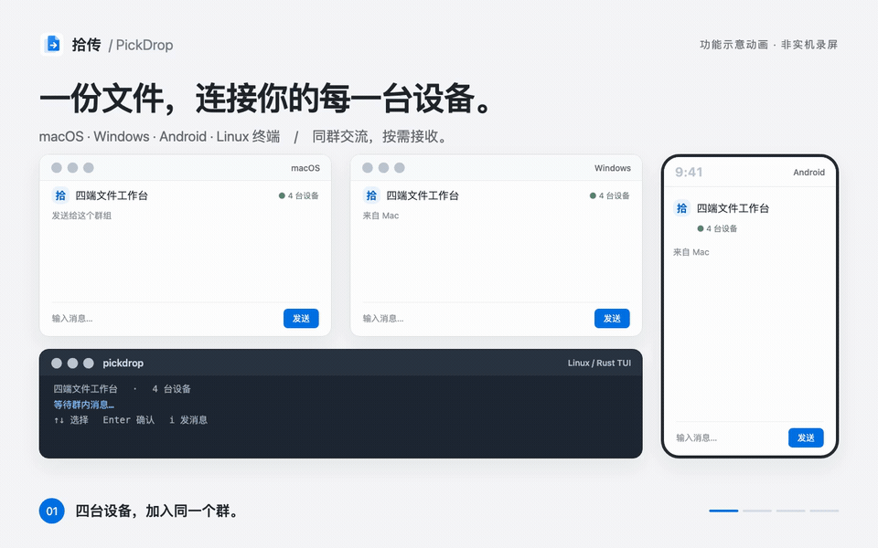

  
  <h1>拾传 · PickDrop</h1>
  
<strong>像聊天一样，在电脑、手机和服务器之间传文件。</strong>

  
macOS · Windows · Android · Linux 终端

  
<a href="#下载安装">下载安装</a> · <a href="#开始使用">开始使用</a> · <a href="#常见问题">常见问题</a>

拾传是一款局域网文件传输工具，支持在电脑、手机和 Linux 终端之间发送文件与文字。把常用设备加入同一个群，随时传递资料、照片和消息。

<a href="assets/readme/demo.mp4">观看视频 · 18 秒</a>

## 让设备之间的传递更顺手

- **群组互传**：文件和文字放在同一个群，发资料时也可以附上一句说明。
- **确认发送**：选择文件、拖入窗口或粘贴图片后，确认目标群组再发送。
- **按需接收**：在需要的设备上下载文件，接收后可打开、另存或分享。
- **多端使用**：桌面窗口可固定或贴边收起；手机全屏使用；Linux 可以通过 SSH 操作。

## 下载安装

**当前版本：v0.6.0。** 在需要互传的设备上分别安装对应版本，无需安装开发工具。

| 设备 | 下载 | 安装方式 |
| --- | --- | --- |
| Mac · Apple 芯片 | [下载 ZIP](https://github.com/lzt2323/shichuan/releases/download/v0.6.0/PickDrop-0.6.0-macOS-arm64.zip) | 解压，将“拾传.app”拖到“应用程序”，然后打开 |
| Windows · x64 | [下载安装程序](https://github.com/lzt2323/shichuan/releases/download/v0.6.0/PickDrop-0.6.0-Windows-x64-setup.exe) | 双击安装程序，按向导完成安装 |
| Android · ARM64 | [下载 APK](https://github.com/lzt2323/shichuan/releases/download/v0.6.0/PickDrop-0.6.0-Android-arm64.apk) | 在手机上打开 APK，按系统提示允许该来源安装 |
| Linux · x64 | [下载终端版](https://github.com/lzt2323/shichuan/releases/download/v0.6.0/PickDrop-0.6.0-Linux-x64-tui.tar.gz) | 解压后在该目录打开终端，运行 `./pickdrop` |

[全部下载与更新说明](https://github.com/lzt2323/shichuan/releases/tag/v0.6.0) · [文件校验值](https://github.com/lzt2323/shichuan/releases/download/v0.6.0/SHA256SUMS.txt)

Android 需要 7.0 或更新版本；Linux 包已在 Ubuntu 22.04 x64 验证。当前没有 iPhone、Intel Mac 或 Linux ARM64 安装包。

**首次安装提示：** Mac 包尚未经过 Apple 公证，Windows 包没有可信发布者签名，系统可能提示未知开发者或阻止打开。请确认文件来自上面的项目 Release；Mac 可在“系统设置 → 隐私与安全性”查看该应用的打开选项，Windows 可在提示中查看“更多信息”。Android 包使用项目专用密钥签名，不需要开启开发者调试。

**用过预览版？** Mac、Windows 和 Android 的 v0.6.0 与“拾传 Preview”可以同时安装。首次打开正式版需要重新加入群，旧聊天记录仍在旧应用中，不会自动搬过来；请保留旧应用和数据，确认需要的文件已保存后再自行整理。

## 开始使用

### 1. 让两台设备连上同一个网络

电脑和手机连接同一个可信 Wi-Fi，或使用彼此可访问的局域网。打开两端拾传，先让手机保持在前台。首次出现局域网访问提示时允许访问；电脑防火墙需允许拾传在可信网络中通信。

### 2. 创建群，邀请另一台设备

1. 在第一台设备点击 **创建群组**，给群起名，例如“我的设备”。
2. 打开 **邀请设备**，显示邀请二维码，也可选择 **复制邀请链接**。
3. 在第二台设备点击 **加入群组**，粘贴邀请链接；Android 也可点击 **扫描二维码**。使用邀请码时，需同时填写第一台设备的地址与端口。
4. 点击 **申请加入**，回到第一台设备批准申请。
5. 在群里发送一句“你好”，确认另一端也能看到。

### 3. 发送并接收第一个文件

1. 在电脑上拖入一个小文件，或使用文件选择入口；手机也可以选择文件。
2. 文件先进入草稿。确认当前群组，再点击 **发送**。
3. 在另一台设备点击文件卡片的接收或保存操作，等待下载和校验完成。
4. 打开保存的文件，确认内容正确。

**另一台设备已经保存并能打开文件，就完成了第一次传输。** “已发送”表示文件消息已经发布，接收端仍需要主动下载。接收完成前，请保持持有文件的设备在线。

### Linux 终端怎么操作

在解压目录运行 `./pickdrop` 后，用 **↑ / ↓** 选择菜单，**Enter** 确认，**Esc** 返回，**i** 输入文字，**Ctrl+C** 退出。

从「邀请 / 加入」进入同一个群；发送文件时先在「发送文件」中暂存，再到「传输 / 草稿」确认发送。接收时在「群内文件」选择文件并确认保存路径。通过 SSH 操作时，看到和保存的文件都在服务器上。

## 常见问题

**找不到设备，或一直连不上？** 先确认双方客户端都在运行、处于同一可互通网络，并已批准入群。访客 Wi-Fi 的设备隔离、VPN 或防火墙可能阻止连接；同一个 Wi-Fi 名称不一定代表设备能互相访问。已加入同群时，可以在设备连接入口尝试手动填写对方地址。

**看到了文件消息，为什么还接收不了？** 文件没有存到云端。需要至少一台持有文件副本的设备在线，并允许接收端连接；发送端退出、缓存被清理或网络被阻断，都可能使下载失败。恢复连接后可重试。

**手机锁屏后还能继续传吗？** 不保证后台长期在线。传输时建议保持拾传在前台，完成后再离开。

**可以给不同场景建立不同群吗？** 可以。例如分别建立“我的设备”和“临时协作”；发送前检查当前群组。已开始的发送不会因为切群而改变目标。

**能在公网或不可信 Wi-Fi 上传敏感文件吗？** 当前没有 TLS 或端到端加密，只适合可信局域网；也没有云中继、云备份或断点续传。

## 反馈与许可

遇到问题可在 [Issues](https://github.com/lzt2323/shichuan/issues) 告诉我们你的设备系统、应用版本、操作步骤和错误提示，请先去除个人信息。更新内容见 [Releases](https://github.com/lzt2323/shichuan/releases)。

拾传采用 [MIT 许可证](LICENSE)。
